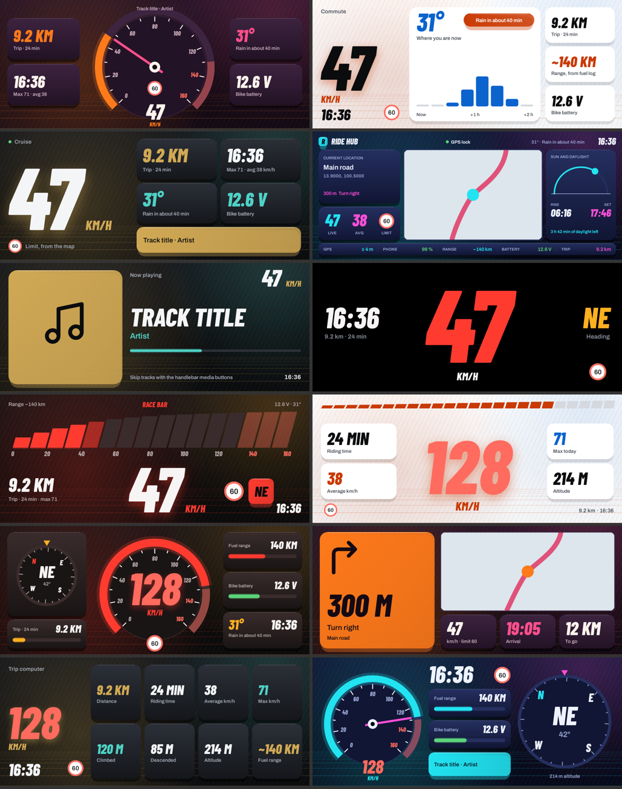

# RideScreen — personal fork

Wireless **Android Auto** on a motorbike's EasyConn / Carbit dash, plus the app's own **ride screens** for the dash: instrument layouts you can switch to instead of Android Auto.

This is a personal fork, set up for a **Zontes 368K**. It is built on two projects, and almost all of the app is their work:

| Project | Author | What it is |
|---|---|---|
| [OpenCfMoto](https://github.com/zanderp/open-cfmoto) | Alexandru (zanderp) | The original app: the Android Auto receiver, the bike link, the built-in map. |
| [RideScreen AA](https://github.com/mgb1982/ridescreen-aa) | Manel (mgb1982) | The fork this one starts from: Zontes support, ride log, parking, maintenance, crash detection, the Wear OS app and much more. |

Their documentation is kept unchanged: [RideScreen AA README](docs/RIDESCREEN-AA-README.md) (Spanish, with an English summary) and [OpenCfMoto README](docs/OPENCFMOTO-README.md). For anything other than the changes listed below, those are the reference. If you want a maintained app with releases and support, use RideScreen AA.

Not affiliated with Zontes, CFMoto or Google. Android Auto is a trademark of Google LLC.

## What this fork changes

### Ride screens on the dash



*Rendered by the app's drawing code with sample values.*

- **Twelve layouts:** Cruise, Street (arc speedometer), Ride hub (live map in the middle), Tourer (next turn and map), Sport, Music, Race bar, Twin dials, Classic (needle speedometer), Commute (rain timeline), Trip computer and Night.
- **Five colour themes:** Gold 368K, Racing red, Neon night, Sunset and Daylight, plus your own accent colour. Optional: Daylight by day and your theme at night, and dimming after sunset.
- **Dash screen page on the phone:** preview, Android Auto / Ride screen / Mirror switch, layout and theme pickers, and which information to show or hide. Changes apply to a running session.
- **Speed alert:** the speed turns red when you are over the limit by a margin you set, with an optional beep.
- **Handlebar:** left and right change the layout, Select changes the theme, Home shows the full map, Back returns. The voice button opens the phone's own assistant.
- **What they show:** GPS speed, trip, max and average speed, heading, altitude, clock, next turn and speed limit from the built-in map, temperature and rain timing, the street you are on, fuel range from the refuel log, bike battery voltage (keyless box), sunrise and sunset, metres climbed and descended, and what the phone is playing.

The bike does not send RPM, gear, fuel level or engine temperature to the app, so the gauges are driven by speed, range, battery and heading.

The ride screens run on the built-in map session: they are drawn over the map, and two layouts leave a window for it.

### Navigation

- **Share a place from Google Maps** (or open a `geo:` link) and choose "Ride there (RideScreen)": it becomes the destination on the built-in map.

### Connection

- **Android Auto is told when a session ends.** Stopping, or the bike switching off, no longer leaves the phone on "Connecting to Android Auto…".
- **Auto-disconnect:** when the bike has been gone for 45 seconds and GPS does not show riding speed, the app stops by itself. Switch it off on the Dash screen page.
- **Connection steps:** Android Auto → bike Wi-Fi → dash on the home screen, with the failing step in red. The watch shows the same step in words, and tapping it offers Stop.

### Look

- Home screen redesign: carbon black, white and gold, a headline that follows the connection state, round shortcuts, pill Connect button and a bottom nav.

### Building and privacy

- **`.github/workflows/apk.yml`** builds the phone and the watch APK on pull requests, working branches and on demand. `build.yml` (releases) is unchanged.
- **The in-app updater only looks at the repository that built the APK**, not at the upstream project's releases.
- Telemetry and live location sharing need a server URL at build time (`TELEMETRY_URL`). Builds from this repository don't set one, so they send nothing.

## Build and install

Run the **APKs (phone + watch)** workflow, or push a branch, and download the two APKs from the run's *Artifacts*.

For builds that install over each other, and for the watch to pair with the phone app, both must be signed with the same key. Put a keystore in the `DEBUG_KEYSTORE_B64` repository secret (base64 of a JKS, alias `androiddebugkey`, passwords `android`). Without it each run signs with a throwaway key.

Locally, with the Android SDK installed:

```bash
./gradlew :app:assembleGithubRelease :wear:assembleGithubRelease
```

Setting up Android Auto's head unit server and pairing with the bike's QR are described in the [RideScreen AA guide](https://ridescreen.app/guia/).

## Status

The changes in this fork compile, their unit tests pass and the ride screens were checked by rendering them off-device. They have **not** been verified on a bike yet.

## Credits and licence

- **OpenCfMoto** © 2026 Alexandru (zanderp) and the OpenCfMoto contributors.
- **RideScreen AA** © 2026 Manel (mgb1982).
- The Android Auto receiver derives from the headunit-revived project (AGPLv3); see [NOTICE](NOTICE) for the full list of incorporated code.
- Fonts: Archivo and Barlow Condensed, both under the SIL Open Font License ([licenses/](licenses/)).

AGPL-3.0-or-later, like both projects it builds on. See [LICENSE](LICENSE) and [NOTICE](NOTICE).
